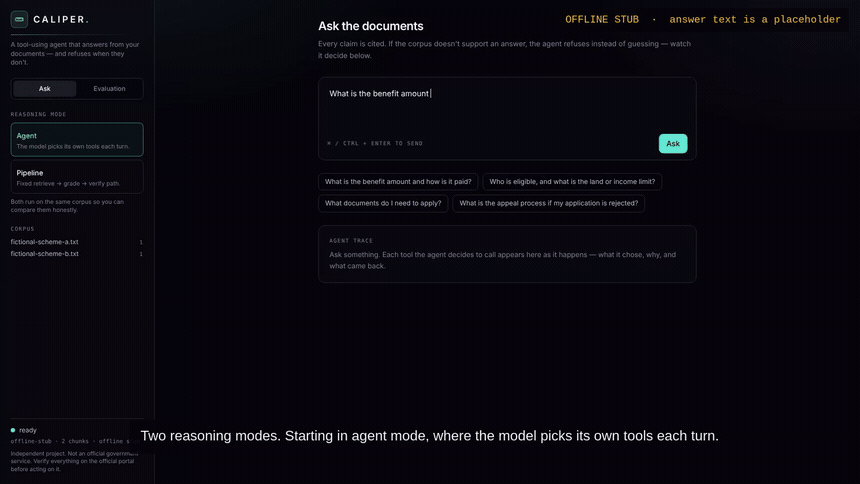

<div align="center">

# 📐 Caliper

### An Evidence Gated Document Agent

Ingest → Retrieve → Grade → Answer → **Verify** → Release or Refuse


**Answers only what the documents support. Cites every claim. Refuses the rest.**

🎬 [Demo video](media/caliper-demo.mp4) · 📊 [Slides](media/caliper-deck.pdf) · 📘 [Documentation](DOCUMENTATION.md)

*A caliper measures precisely. This one measures whether its own answers are actually supported by the documents it read.*

</div>

---

## 🎬 Demo



An answer released with its citation, then a draft withheld because the sources did not support it.

| | |
|---|---|
| 🎥 **Full walkthrough, 64 seconds** | [`media/caliper-demo.mp4`](media/caliper-demo.mp4) · one answer and all three refusal paths, with the agent trace and the cost panel |
| 📊 **Presentation, 13 slides** | [`media/caliper-deck.pdf`](media/caliper-deck.pdf) · architecture, the three refusal paths, the evaluation design and references |
| 📘 **Full documentation** | [`DOCUMENTATION.md`](DOCUMENTATION.md) · every module, every command, verified by running it |

Both recordings used the deterministic offline stub, so the answer *text* is a placeholder. What they show is the decision path and the refusal gates, not answer quality. See [Results](#-results).

---

## 🎯 Why refusal is the feature

A demo that answers everything is easy. The hard part, and the part that matters when the subject is who qualifies for a ₹6,000 benefit, is knowing when the retrieved text does **not** settle the question.

So the agent has two reflection points and is measured on the questions it should decline:

| Reflection point | What it decides |
|---|---|
| **grade / plan** | Before answering, whether what it gathered is genuinely relevant. Topical overlap is not relevance. |
| **verify** | After drafting, whether every claim is supported by the source text. An unsupported draft is withheld, not returned. |

The eval harness runs the whole question set twice, verification off then on, and reports the difference. That number goes in this README whichever way it points.

---

## 🧠 Two reasoning modes, same corpus

The point is the comparison. Both are tested, and both run in the eval harness.

**Agent mode.** The model is shown a toolbox and decides, each turn, what to call and with what arguments. It sees the result and decides again.

```
question → ┌─ plan ──→ act ──→ observe ─┐ → answer → verify → ✓ / refuse
           └────── loop, max 5 steps ───┘
```

**Pipeline mode.** A fixed path with no tool choice.

```
route → retrieve → grade ─┬─ generate → verify → ✓ / refuse
                          ├─ rewrite (≤2) ↺
                          └─ no evidence → refuse
```

### 🧰 The toolbox

| Tool | What it does |
|---|---|
| `search_documents(query)` | hybrid dense and BM25 retrieval over the corpus |
| `lookup_number(query)` | the same retrieval, re ranked toward passages containing figures |
| `calculate(expression)` | arithmetic parsed from an AST, never `eval()` |
| `current_date()` | today, for deadline and window questions |
| `finish(reason)` | stop gathering: enough evidence, or clearly none |

A failing tool returns `{"ok": false, "error": ...}` rather than raising, so one bad call degrades that step and the agent can choose differently next turn.

**The step budget is not decoration.** An unbounded agent loop with a paid model behind it is a bill, and `test_loop_is_bounded_by_max_steps` proves a runaway planner stops at `MAX_STEPS`.

### 🔍 Why hybrid retrieval

Scheme documents are full of exact tokens a dense embedding blurs: `SC/ST`, `₹6,000`, `2 hectares`, `Section 4(2)`. Dense search alone misses those, BM25 alone misses paraphrase. Reciprocal Rank Fusion combines them by **rank position**, not score, because a cosine similarity of 0.82 and a BM25 score of 14.3 are not on comparable scales. Averaging them is meaningless.

---

## 🖥️ The interface

React with Vite and Tailwind, streaming over server sent events.

- **The agent's reasoning, live.** Each tool call appears as it happens: what it chose, its stated reason, the arguments, how long it took, what came back. Not a spinner.
- **Citations as chips.** `[S1]` markers in the answer are clickable and tied to the source list.
- **A cost panel on every answer.** Latency, tokens in and out, model calls, tool calls, and cost per request.
- **Refusals that look deliberate**, not broken.
- **An evaluation view** with live service metrics and p95 latency per graph node.

`POST /ask/stream` is server sent events. `EventSource` only does GET and the question belongs in a POST body, so the frontend parses SSE frames off the fetch body stream by hand.

---

## 💰 Cost is `null` on purpose

`cost_usd` stays `null` until you fill `config/pricing.yaml` and set `verified: true` with the date you read the official pricing page.

Published token prices change. A cost figure whose provenance nobody recorded is worse than an honest "unconfigured", so the code refuses to invent one. The UI explains this where the number would be.

---

## 📊 Results

> Run `make eval-compare` against your own corpus and paste the real output here.
> Leave it blank rather than filling it with numbers you have not measured. An unfilled table costs you nothing, an invented one costs you the interview.

| Metric | verify OFF | verify ON |
|---|---|---|
| Answer accuracy (answerable) | | |
| Refusal accuracy (unanswerable) | | |
| Routing accuracy (out of scope) | | |
| **Hallucination rate** | | |
| Latency p50 / p95 | | |
| Cost per question | | |

**Agent against pipeline**, same question set:

| Metric | pipeline | agent |
|---|---|---|
| Answer accuracy | | |
| Hallucination rate | | |
| Tool calls per question | n/a | |
| Tokens per question | | |

Corpus: _N documents, M chunks, ingested YYYY-MM-DD._
Evaluation set: _K questions: answerable / unanswerable / out of scope._

### ⚠️ Known limitations

- BM25 is built in process by scanning the collection at startup. Fine at a few thousand chunks, replace with Qdrant sparse vectors before it is not.
- `verify` costs an extra model call per request. The ablation above is the data needed to decide whether that is worth paying.
- Scanned PDFs with no text layer ingest as nothing. `app.ingest` reports the count of empty pages, run OCR on those first.
- No recall@k against a labelled relevance set. Retrieval is measured end to end only.
- Single turn. No conversation memory.
- CORS is wide open for local development. Narrow it before deploying anywhere real.

---

## 🚀 Running it

### See the UI in two minutes, with no API key, no network and no Qdrant

```bash
pip install -r requirements.txt
python scripts/dev_offline.py          # API on :8000, stub model, fictional corpus

cd frontend && npm install && npm run dev   # UI on :5173
```

A deterministic stub stands in for the model. Nothing it answers means anything, the schemes are invented, but every endpoint, the streaming trace and the whole UI work end to end on a fresh clone.

```bash
make test        # 69 tests, fully offline
```

### For real

```bash
cp .env.example .env          # add your GEMINI_API_KEY
docker compose up -d qdrant   # vector store on :6333

# put scheme PDFs in docs/ — see SOURCES.md
python -m app.ingest docs/ --dry-run   # check chunking and scanned-page count
python -m app.ingest docs/

make run                      # API  → http://localhost:8000/docs
cd frontend && npm run dev    # UI   → http://localhost:5173
```

Then write `eval/questions.yaml` from your own documents, copying `eval/questions.example.yaml`, and run:

```bash
make eval-compare
make loadtest
```

### Deploying

```bash
gcloud run deploy caliper \
  --source . --region asia-south1 --allow-unauthenticated \
  --set-env-vars "QDRANT_URL=<your qdrant url>,GEN_MODEL=gemini-2.5-flash" \
  --set-secrets "GEMINI_API_KEY=gemini-key:latest"
```

The container reads `$PORT`, runs as a non root user, and ships no secrets.

---

## 🗂️ Layout

```
app/
  config.py         settings; pricing loaded from YAML, never hardcoded
  llm.py            Gemini client, offline stub, token and cost metering
  tools.py          the agent's toolbox + an AST-parsed calculator
  store.py          chunking, Qdrant dense search, BM25, RRF fusion
  ingest.py         PDF/text → chunks → embeddings, reports empty pages
  observability.py  rolling metrics window + JSONL request traces
  graph/
    nodes.py        route, retrieve, grade, rewrite, generate, verify
    agent.py        the plan → act → observe loop
    build.py        both graphs, with a verify-off ablation path
  main.py           /ask, /ask/stream (SSE), /metrics, /healthz, /documents
frontend/           React + Vite + Tailwind; live agent trace, citations, cost
eval/               question set, harness, ablation
tests/              69 offline tests
media/              demo video, preview GIF, slide deck
scripts/
  dev_offline.py    whole stack with no key and no Qdrant
  loadtest.py       concurrency test reporting p50/p95/p99 and errors
```

---

## ✍️ Writing the question set

The evaluation set is the project. Three kinds, and the second is the one most RAG demos skip:

| Kind | What it tests |
|---|---|
| **answerable** | The corpus settles it. Checked against required substrings and the expected citation source. |
| **unanswerable** | Plausible, on topic, genuinely not in the documents. The system must refuse. The share it answers anyway is the hallucination rate. |
| **out_of_scope** | Not about the corpus at all. Refused before any retrieval spend. |

Grading is substring and citation assertions against a human written key, not a model marking its own homework.

---

## 📄 Disclaimer

**This is an independent engineering project. It is not affiliated with, endorsed by, or operated on behalf of any government department or agency.**

- Answers come from whatever documents were ingested, which may be outdated, incomplete or superseded. **Always verify eligibility, benefit amounts and deadlines on the scheme's official portal before acting.**
- Nothing here is legal, financial or benefits advice.
- This repository distributes **no government documents**. It ships the ingestion pipeline, and the operator downloads source documents themselves from official portals. See `SOURCES.md`.
- No government logo, emblem, seal or branding is used anywhere, and "Caliper" is not presented as an official service.
- No personal data is collected. The question text and timings are written to a local trace file so latency and cost can be measured. The service asks for no Aadhaar number, bank detail or other identifier, and you should not send one.
- Fetch source documents manually and respect each portal's terms of use. Do not bulk scrape.

---

## 📜 Licence

MIT. Applies to this source code only, not to any document you ingest.

<div align="center">

**Bollu Jnana Keerthana** · [jnanabollu@gmail.com](mailto:jnanabollu@gmail.com) · [github.com/Jnana1964](https://github.com/Jnana1964)

</div>
